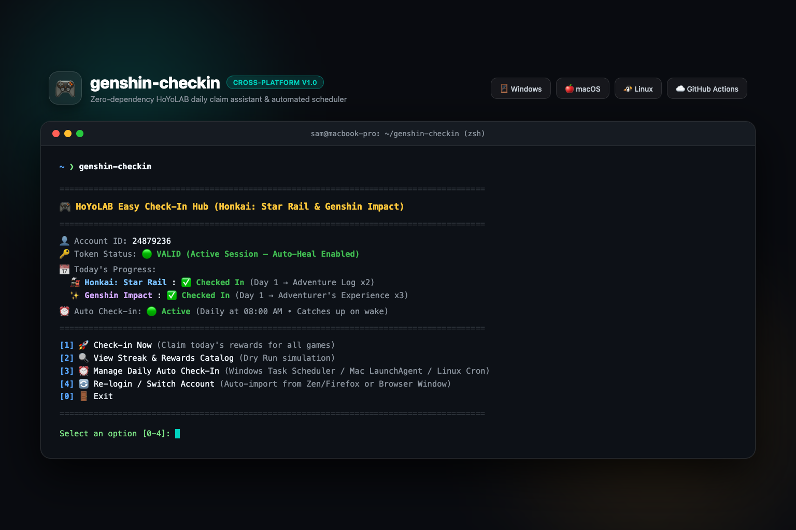

# 🎮 genshin-checkin — HoYoLAB Easy Check-In Hub

<p align="center">
  
</p>

[](https://www.python.org/)
[](LICENSE)
[](#)
[](#)

A zero-dependency, cross-platform CLI hub and daily rewards check-in assistant for **Honkai: Star Rail**, **Genshin Impact**, and **Zenless Zone Zero**.

Built around a simple philosophy: **"Let you check in easily."** No manual token hunting, no inspect element hassles, and optional background automation whenever you want it.

---

## 🌟 Features

- **Zero Core Dependencies**: Runs purely on standard Python 3 (`urllib`, `sqlite3`, `json`). No `pip install` needed for core operations.
- **One-Click Session Auto-Import**: Instantly detects and imports active HoYoLAB sessions from your desktop browser (**Zen Browser**, **Mozilla Firefox**, **Floorp**) in under 0.1 seconds.
- **Interactive Browser Window**: Built-in visual login window for Google, Apple ID, and Email/Password logins without touching DevTools.
- **Dynamic Terminal Dashboard**: Displays your account UID, token validity, today's claim progress, streak counts, and auto-scheduler status at a glance.
- **Cross-Platform Daily Automation**:
  - **Windows**: Built-in 1-click **Windows Task Scheduler** integration (`schtasks`).
  - **macOS**: Built-in **LaunchAgent** (`launchd`) configuration that wakes up from sleep to claim rewards.
  - **Linux**: Automatic **Crontab** scheduler.
  - **Cloud 24/7**: Ready-to-use **GitHub Actions** cron workflow.
- **Auto-Heal on Token Expiry**: Automatically attempts to refresh session cookies from your active browser if tokens expire.
- **Discord & Desktop Notifications**: Optional native macOS notifications and Discord webhook embeds.

---

## 🖥️ Terminal Dashboard

```text
==========================================================
🎮  HoYoLAB Easy Check-In Hub (HSR & Genshin)
==========================================================
👤 Account ID:    24879236
🔑 Token Status:  🟢 VALID (Active)
📅 Today's Status:
   🚂 Honkai: Star Rail  : ✅ Checked In (Day 1)
   ✨ Genshin Impact     : ✅ Checked In (Day 1)
⏰ Auto Check-in: 🟢 Active (macOS LaunchAgent / Windows Task)
==========================================================
 [1] 🚀 Check-in Now (Claim Today's Rewards)
 [2] 🔍 View Streak & Rewards Catalog (Dry Run)
 [3] ⏰ Manage Daily Auto Check-In (Windows / Mac / Linux)
 [4] 🔄 Re-login / Switch Account
 [0] 🚪 Exit
==========================================================
Select an option [0-4]: 
```

---

## ⚡ Quick Start

### 🍎 macOS & 🐧 Linux

Install with a single command:
```bash
curl -sSL https://raw.githubusercontent.com/sammmms/genshin-checkin/main/install.sh | bash
```

Then simply run:
```bash
genshin-checkin
```

### 🪟 Windows

1. Download or clone this repository.
2. Double-click **`genshin-checkin.bat`** *(or run `python checkin.py` in PowerShell/CMD)*.

---

## 🔑 Login Options (No Inspect / F12 Required)

Inside the interactive menu, choose **`[4] Re-login / Switch Account`** (or run `genshin-checkin --login`):

1. **Auto-Import from Browser [Instant]**:
   Directly reads active cookies from your installed browser session.
2. **Interactive Browser Window**:
   Opens a real browser window to HoYoLAB. Log in with Google, Apple, or Email. Tokens are captured and saved automatically.
3. **Manual Paste**:
   Paste `ltoken_v2` and `ltuid_v2` directly into `~/.hoyolab-checkin/.env`.

---

## ⏰ Background Automation (Optional)

Choose option **`[3] Manage Daily Auto Check-In`** in the menu:

- **Windows**: Creates a daily background task in **Windows Task Scheduler** at 08:00 AM.
- **macOS**: Registers a **LaunchAgent** at 08:00 AM local time (runs immediately upon waking if the lid was closed).
- **Linux**: Adds a scheduled entry to your user **Crontab**.
- **GitHub Actions (24/7 Cloud)**: Fork this repo, add `HOYO_COOKIE` to your repository Secrets, and GitHub will claim rewards automatically at 01:00 UTC daily.

---

## 🛠️ CLI Flags (Power Users)

```bash
genshin-checkin --dry-run             # Check status and streak without claiming
genshin-checkin --game starrail       # Claim Honkai: Star Rail only
genshin-checkin --game genshin        # Claim Genshin Impact only
genshin-checkin --import-browser      # Run instant browser cookie import
genshin-checkin --login-browser       # Open visual login window
genshin-checkin --install-schedule    # Enable daily background schedule
genshin-checkin --remove-schedule     # Disable daily background schedule
```

---

## 🔒 Security & Privacy

- All credentials (`ltoken_v2`, `ltuid_v2`) are stored locally in `~/.hoyolab-checkin/.env` with strict `0600` file permissions.
- Cookies are never transmitted anywhere except directly to official HoYoverse API servers (`*.hoyolab.com`).
- The project is 100% open source and inspectable.

---

## 📄 License

MIT License © 2026 [Sam](https://github.com/sammmms).
